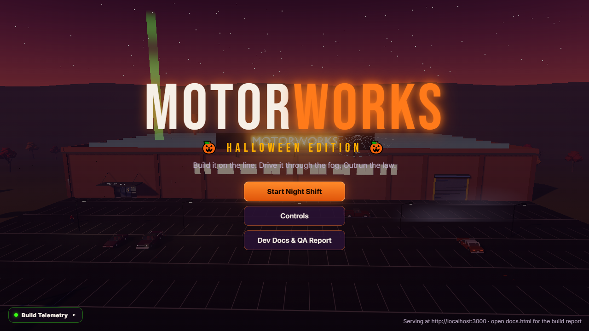
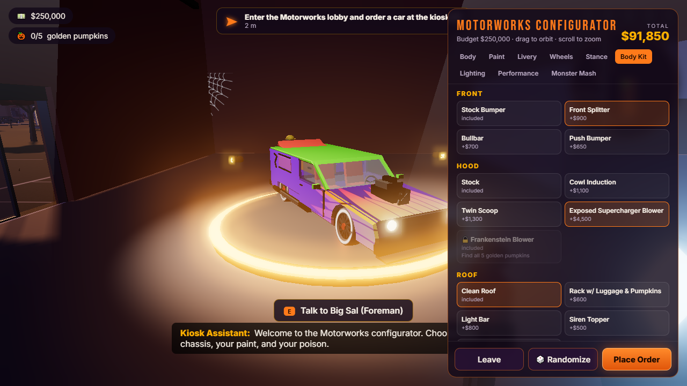
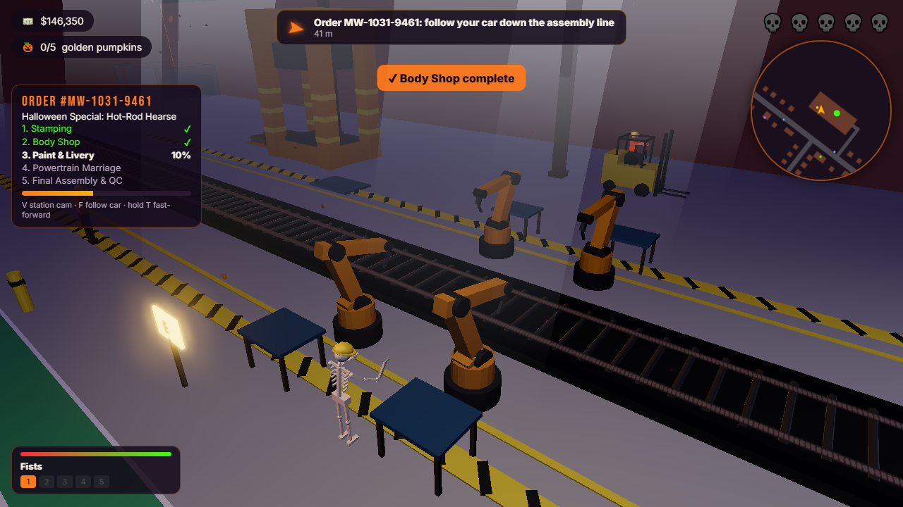
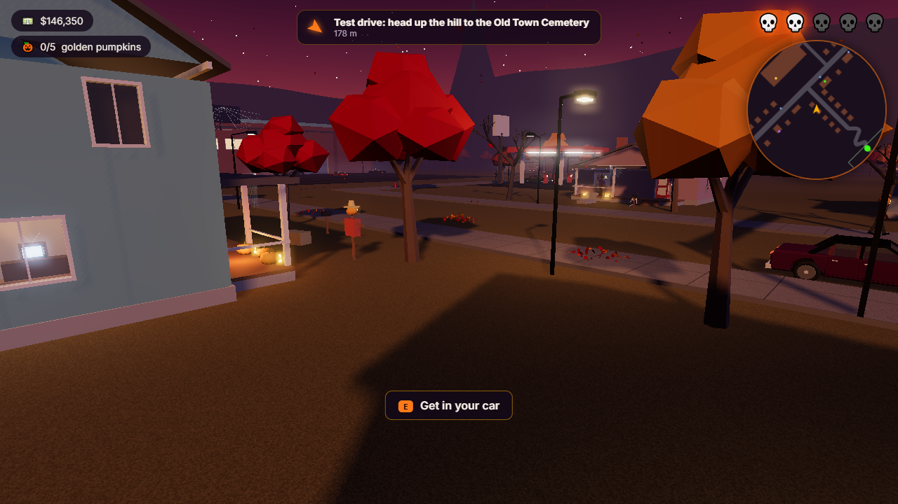
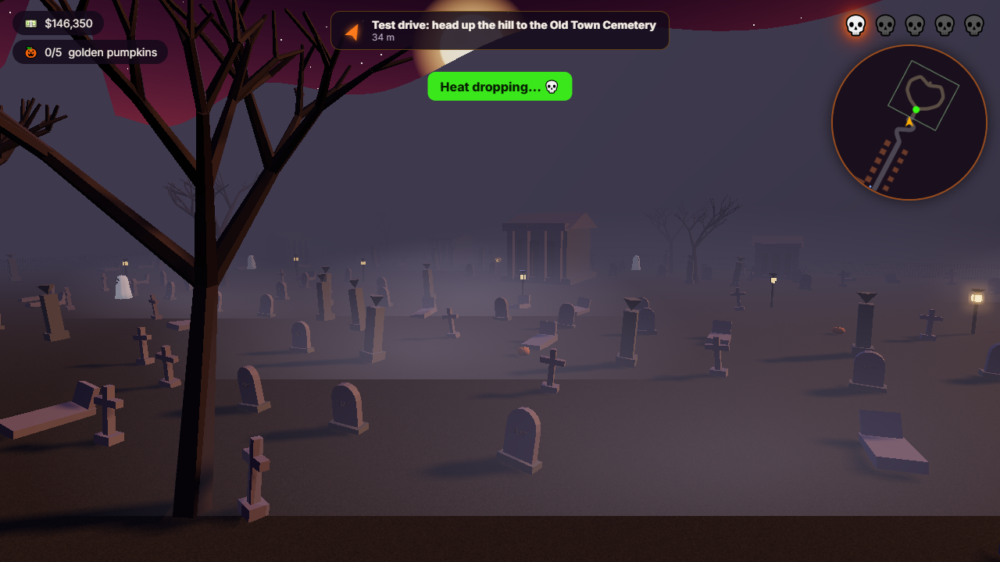
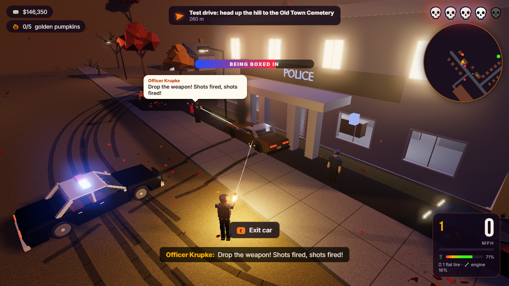
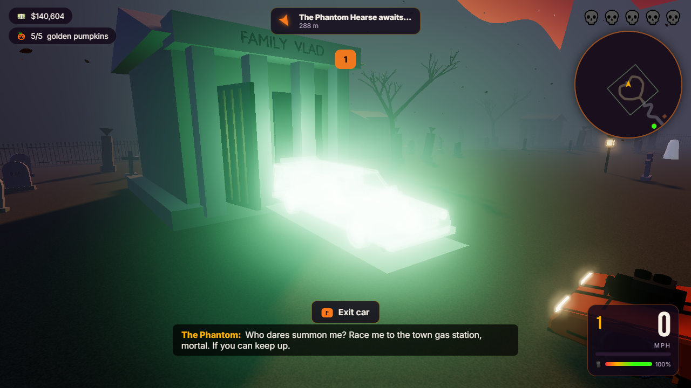

<div align="center">

# 🎃 MOTORWORKS — Halloween Edition

**Build it on the line. Drive it through the fog. Outrun the law.**

A third-person 3D car factory, customization and open-town action game that runs in the browser.

[](https://thebenn.me/motorworks-halloween/)
[](https://thebenn.me/motorworks-halloween/docs.html)




</div>

> [!WARNING]
> **🚧 Work in progress.** The game is playable from start to finish, but it is still rough around the edges. Art is stylised and procedural, and balance and AI are early. Expect bugs and changes. Feedback and issues are welcome!

---

## ✨ What's in it

<table>
<tr>
<td width="50%"></td>
<td width="50%"></td>
</tr>
<tr>
<td><b>🛠 Configuration kiosk</b>: 4 bodies (Muscle, V8 Pickup, Street Coupe, Hot-Rod Hearse), 5 paint finishes (from Midnight Pearlescent to Haunted Rust), liveries, 6 rim styles, stance, body kits, an animated supercharger, underglow, and engine, gearbox and tire tuning, all shown on a live 3D turntable.</td>
<td><b>🏭 5-station assembly line</b>: a stamping press, welding robots that hang the doors on their hinges, a paint booth, engine marriage and a laser QC scanner. Watch from the floor or from station cams (<kbd>V</kbd>). Hold <kbd>T</kbd> to fast-forward.</td>
</tr>
<tr>
<td></td>
<td></td>
</tr>
<tr>
<td><b>🍂 A small American town at Halloween</b>: Main Street with a diner, gas station, hardware store and police station, decorated suburbs, leaf piles that scatter when you drive through, falling leaves and a harvest moon.</td>
<td><b>⚰️ The Old Town Cemetery</b>: a foggy hill road, creaking iron gates, crypts, crooked tombstones and the timed <b>Graveyard Shift</b> drift trial.</td>
</tr>
<tr>
<td></td>
<td></td>
</tr>
<tr>
<td><b>🚓 Car theft and police</b>: steal any parked or stopped car. Hinged doors swing open, alarms go off and drivers flee. Earn a 1–5 💀 wanted level, then lose the AI cruisers in the fog or with a respray at the Custom Bay, or get <b>BUSTED</b>.</td>
<td><b>👻 Easter eggs</b>: the Phantom Hearse race, Bones the skeleton welder, 5 hidden Golden Pumpkins that unlock the Monster Mash pack, and a haunted procedural car radio.</td>
</tr>
</table>

**Under the hood:**
- 🚗 Raycast-vehicle physics with body roll, handbrake drifts, skid marks, and chase and cockpit cameras.
- 🗣 54 voiced lines across 14 characters, made with ElevenLabs and given per-character radio, ghost and robot effects.
- 🔊 Synthesised engine, siren and SFX.
- 🎛 Pause menu with volume and graphics settings, plus automatic quality fallback for slower GPUs.

## 🎮 Controls

| Key | Action | Key | Action |
|---|---|---|---|
| <kbd>W</kbd><kbd>A</kbd><kbd>S</kbd><kbd>D</kbd> | Walk / drive & steer | <kbd>E</kbd> | Interact · talk · enter / steal / exit car |
| Mouse | Orbit camera | <kbd>Space</kbd> | Jump · handbrake drift |
| <kbd>Shift</kbd> | Sprint | <kbd>C</kbd> | Chase ⇄ cockpit cam |
| <kbd>H</kbd> | Horn | <kbd>R</kbd> | Haunted radio |
| <kbd>V</kbd> / <kbd>F</kbd> / <kbd>T</kbd> | Station cam / follow car / fast-forward build | <kbd>N</kbd> | Toggle waypoint guide |
| <kbd>Backspace</kbd> | Reset car upright | <kbd>Esc</kbd> | Pause & settings |

## 🚀 Run it locally

```bash
git clone https://github.com/BMKoscak/motorworks-halloween.git
cd motorworks-halloween
npm install
npm run dev
```

The dev server prints its URL, http://localhost:3000. It also binds `0.0.0.0`, so you can play from other devices on your LAN.

| Script | What it does |
|---|---|
| `npm run dev` | Vite dev server on port 3000 |
| `npm run build` | Production build into `dist/`, which is what GitHub Pages serves |
| `npm run assets` | Regenerates all 27 `.glb` models with headless **Blender** (`blender/build_*.py`) |
| `npm run dialogue` | Voice pipeline: ElevenLabs if `ELEVENLABS_API_KEY` is set, otherwise local TTS (cached, never re-billed) |
| `npm test` | Automated **Playwright** QA loop: 20 checks plus documentation screenshots |
| `node scripts/build-docs.mjs` | Rebuilds `DOCUMENTATION.md`, `docs.html` and `TELEMETRY.json` |

## 🧱 How it's built

```
blender/          Procedural Blender scripts → public/models/*.glb (hinged doors, pivots, COL_ colliders)
src/core/         input · asset loading · cannon-es physics · static batching · vertex-colour baking · cameras
src/world/        terrain · town · cemetery · factory · sky, fog & falling leaves
src/vehicle/      car visual + paint/livery shader · raycast vehicle · effects
src/actors/       articulated characters · player controller
src/systems/      assembly line · kiosk · traffic & theft · police · NPCs · missions · audio & radio
tests/            Playwright QA suite + probes
```

- **Every 3D model is generated in Blender from Python.** No assets were downloaded. Moving parts are separate nodes whose origin sits on the real hinge, so doors, hoods, trunks, wheels, robot joints, gates and limbs all rotate naturally.
- **Performance.** Static scenery is batched by material and 64 m cell, and civilian cars and characters are baked into vertex-coloured parts. That cut draw calls by more than half.
- **QA.** The automated suite drives the real game with keypresses and checks hinges, steering under throttle, collisions, stuck keys, theft, wanted level and busting, dialogue playback and the easter eggs. It also captures the screenshots used in the [docs](DOCUMENTATION.md).

See **[DOCUMENTATION.md](DOCUMENTATION.md)** for the full build log, QA report, telemetry and all 70 screenshots.

## 🗺 Roadmap (WIP)

- [ ] Better car silhouettes and more interior detail
- [ ] Smarter police AI that blocks and reads the road network
- [ ] Damage model, plus a garage to save and load builds
- [ ] More missions, plus a day/night cycle on Halloween night
- [ ] Gamepad and mobile touch controls
- [ ] Performance pass for low-end laptops

## 🙏 Credits

- Voices by **ElevenLabs** (eleven_v4), in voice-library voices listed in the docs.
- Built with [Three.js](https://threejs.org), [cannon-es](https://github.com/pmndrs/cannon-es), [Vite](https://vitejs.dev), [Blender](https://www.blender.org) and [Playwright](https://playwright.dev).
- Designed and developed with the help of Claude (Anthropic).

<div align="center"><sub>🎃 Happy Halloween, and drive safe out there. The dead are restless tonight. 🎃</sub></div>
