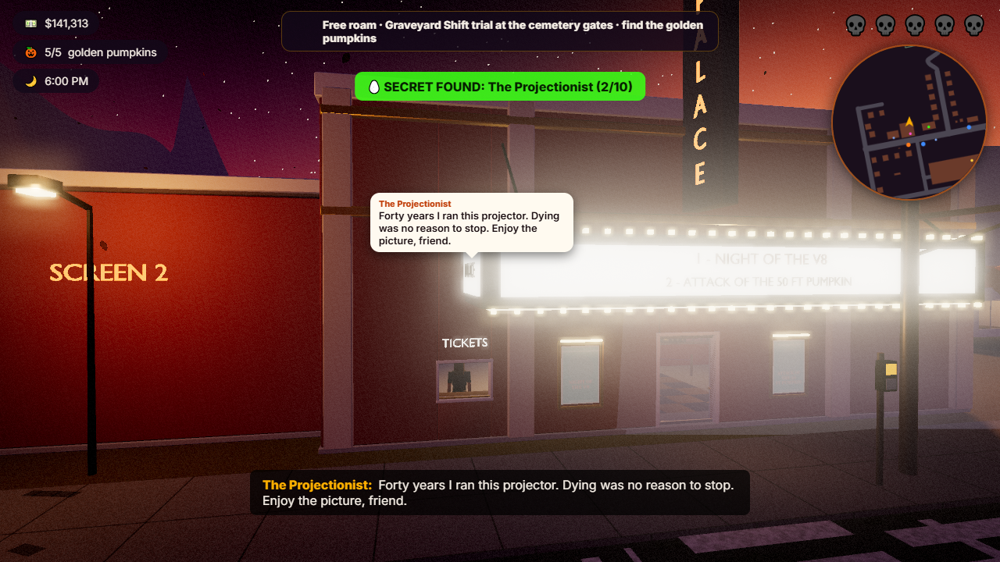
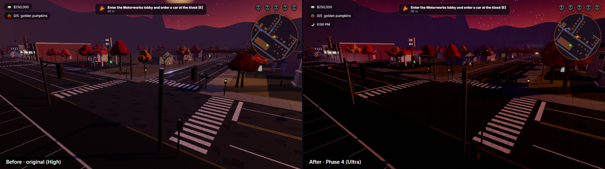
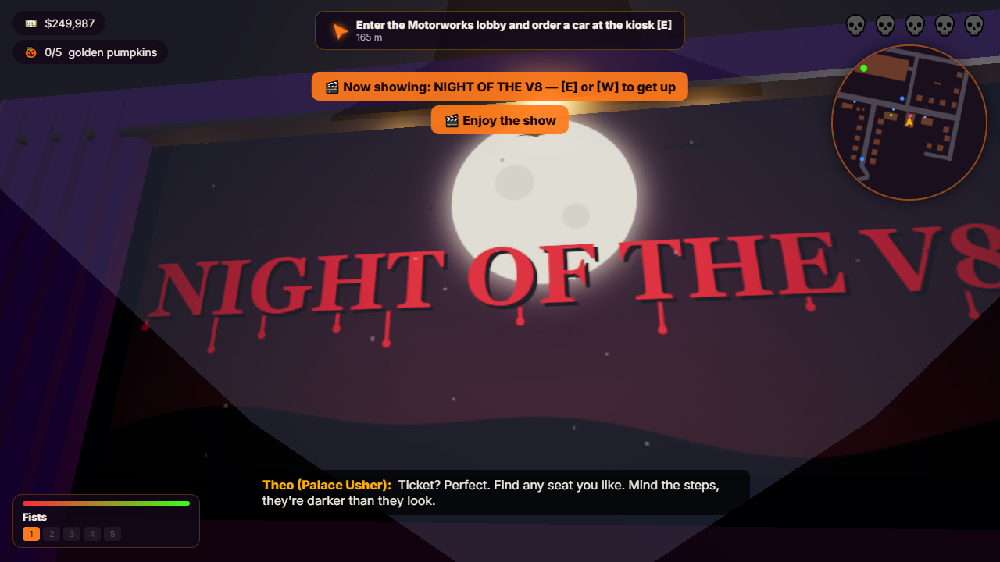
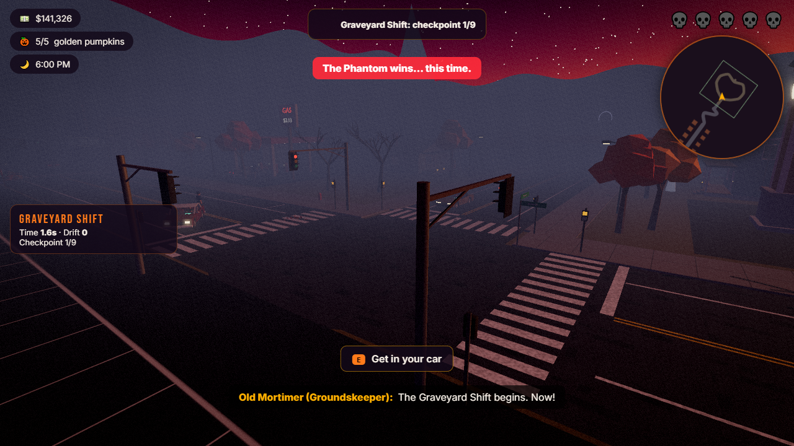
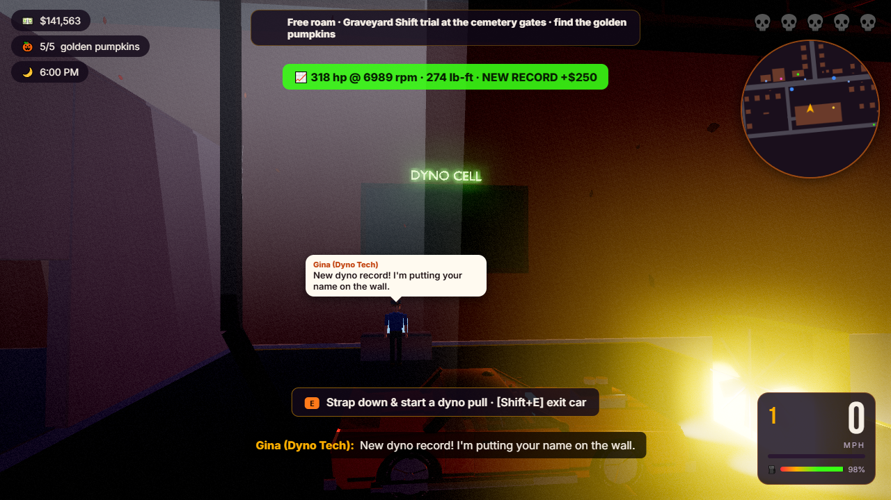
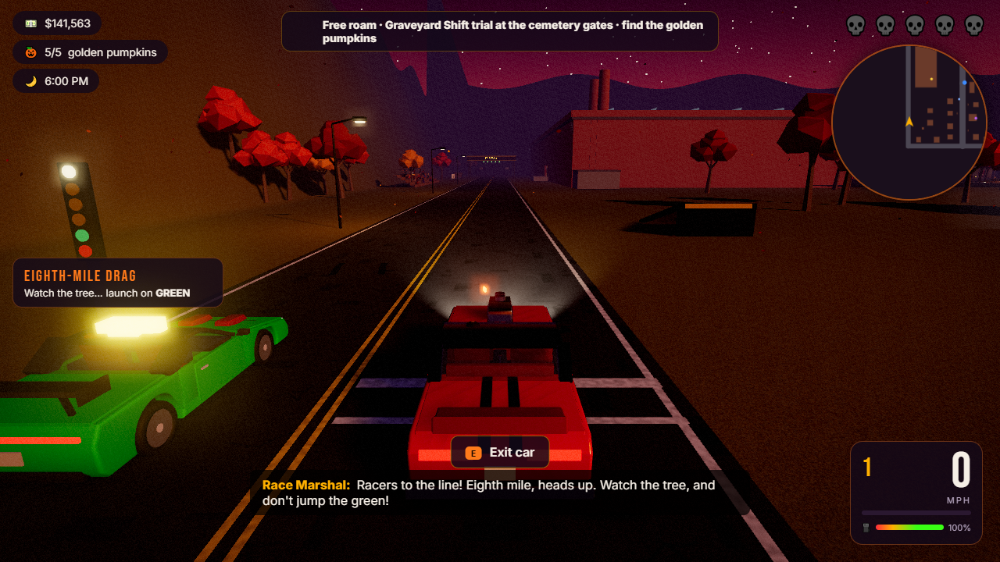
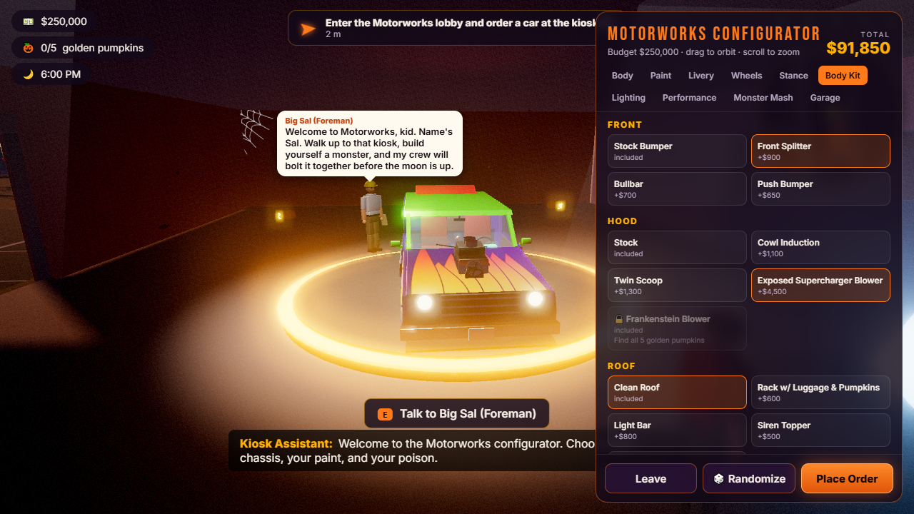
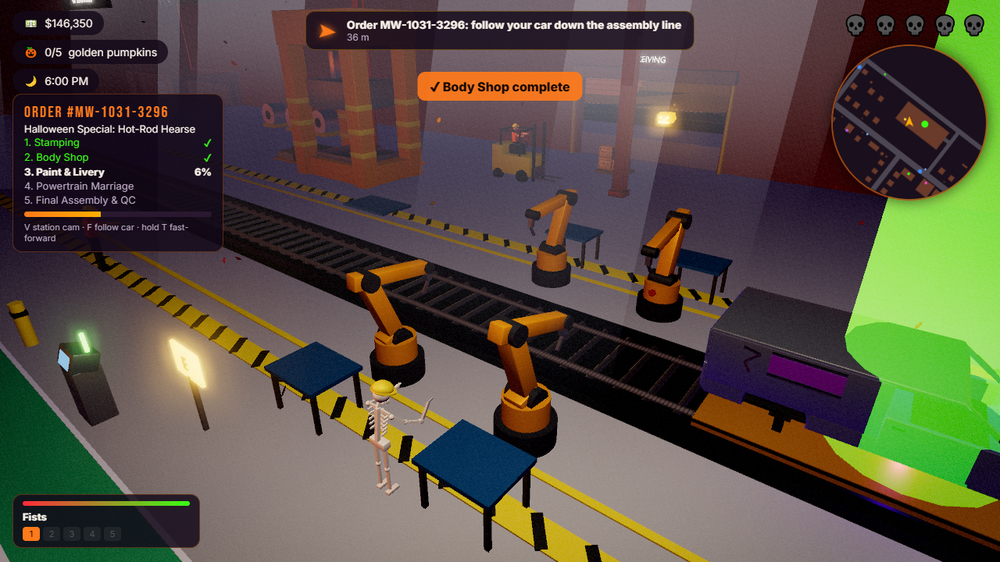
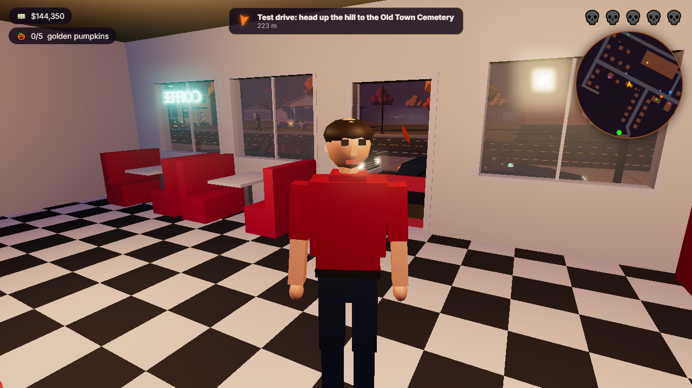
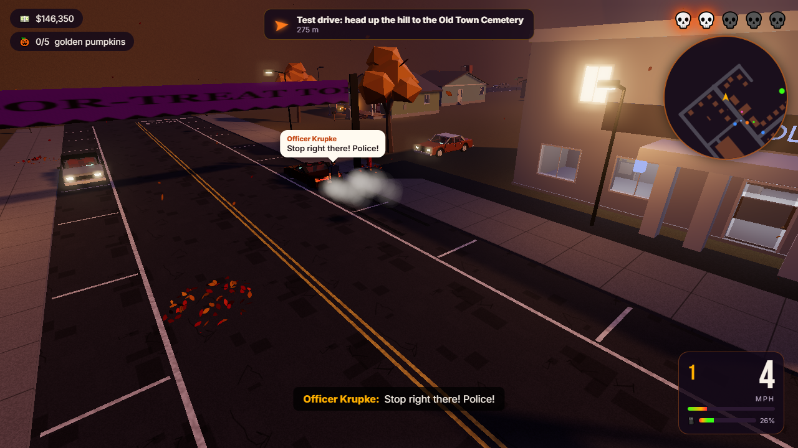

<div align="center">

# 🎃 MOTORWORKS — Halloween Edition

**Build it on the line. Drive it through the fog. Catch a movie. Outrun the law.**

A third-person 3D car factory, customization and open-town action game that runs in the browser.

[](https://thebenn.me/motorworks-halloween/)
[](https://thebenn.me/motorworks-halloween/docs.html)


-39ff14?style=flat-square)



</div>

> [!WARNING]
> **🚧 Work in progress.** The game is playable from start to finish, but it is still rough around the edges. Art is stylised and procedural, and balance and AI are still being tuned. Expect bugs and changes. Feedback and issues are welcome!

---

## 🆕 Phase 4: RTX graphics & the roadmap, done



- 🎨 **A new render pipeline for modern GPUs.** It adds 4× MSAA (the old composer never actually anti-aliased), **GTAO ambient occlusion**, **sky reflections** on paint and chrome, a Halloween colour grade, stable 4K shadows and **real headlight beams**. There's a new **Ultra** preset, picked automatically on RTX-class GPUs, and it falls back to High if the frame rate dips.
- 🧊 **Every Blender model upgraded.** Boxes get rounded edges, car panels get round-edged profiles, curves get 2× the segments, and everything uses smooth-by-angle normals. That's 3.1× the triangles, with the colliders untouched.
- ⚡ **Faster despite all that.** The simulation dropped from 13–16 ms to 4–7 ms a frame: physics skips 3,300 static colliders, the Jumbotron only renders when you can see it, and hidden subtrees and far shadows are culled. High now runs **45–100 fps where it ran 26–43**.
- 🏁 **Drag-race fix.** Staging at the christmas tree no longer lifts your car about 100 m into the sky and drops it on green.
- 🌗 **A day/night cycle.** Dusk, a moonlit night, an orange dawn and an overcast autumn day, with a HUD clock and a pause-menu time slider.
- 🚦 **AI turn signals and overtaking.** Traffic blinks before turns and pulls around cars abandoned in the lane. Before, it rammed them.
- 💥 **A damage model.** Dents, a sprung hood, flickering headlights, scuffed paint and bent alignment. The Custom Bay fixes it all. There's also a **🗄️ Garage** tab in the kiosk for saving and loading builds.
- 🎬 **Palace Screen 2.** A new annex auditorium shows a second film, ***ATTACK OF THE 50 FT PUMPKIN***, which is also the drive-in's midnight movie.
- 🎮 **Gamepad and 📱 touch controls.**

Full build log, measurements and before/after shots: **[DOCUMENTATION.md §11](DOCUMENTATION.md#11-phase-4-build-log-rtx-graphics-performance-drag-race-fix-and-the-roadmap)**.

## Phase 3: Fright Night update

- 🛣️ **Real streets.** The whole road network is now a Blender asset generated from one `streets.json` map. It has asphalt with junction pads, double-yellow centre lines, edge lines, parking ticks, zebra crosswalks, stop bars, painted STOP, street-name signs, speed limits and manholes. **Working traffic lights with walk signals** run at Main & Elm and Main & Factory Rd, with stop signs everywhere else.
- 🗺️ **A bigger town.** It now has an outer ring road (Maple Ave, Oak Ave and Proving Ground Rd), more houses, bus shelters and a town square with a clocktower and gazebo. You'll also find the Starlight Drive-In, the Hollow Cider Mill, a water tower and the Proving Ground drag strip with bleachers.
- 🎬 **The Palace Cinema.** It's a walk-in art-deco picture house with a marquee, box office, concession stand, usher, 8 raked rows of seats and a projection booth. It plays a fully voiced 100-second B-movie, ***NIGHT OF THE V8***, which is projected live onto the Palace screen *and* the drive-in screen.
- 🏭 **More to do at Motorworks:**
  - a **dyno cell** with a live power-curve display and a leaderboard
  - **Parts Runner** shifts that pay you to rush crates from receiving to the line
  - a break room with the **PUMPKIN PANIC** arcade cabinet and a soda machine
  - an **eighth-mile drag race** against Vic Vapor on the Proving Ground
- 🧠 **Smarter NPCs:**
  - AI traffic stops for red lights and stop signs.
  - Drivers honk when you block them and yell when you ram them.
  - Townsfolk run errands on a sidewalk network and wait for WALK or a gap in traffic. They cross at crosswalks, sit on benches and wait for the bus, chat with each other, and jump back when you honk.
  - Trick-or-treaters go door to door and get candy.
- 🥚 **10 secrets** to find (tracked in the pause menu) and **stunt ramps** that pay for airtime.
- 🗣️ **49 new ElevenLabs voice lines** from 11 new voices, including a trailer narrator, a heroine, a vampire villain, an usher, a box-office clerk, a dyno tech, a race marshal, a rival racer and a haunted payphone.

## ✨ What's in it

<table>
<tr>
<td width="50%"></td>
<td width="50%"></td>
</tr>
<tr>
<td><b>🎬 The Palace & the Starlight Drive-In</b>: buy a ticket ($8), grab popcorn and sit down to watch <i>Night of the V8</i>. The usher won't let you in without a ticket. At the drive-in you watch from your car while the soundtrack plays over the radio.</td>
<td><b>🚦 Streets that work</b>: Blender-modelled roads, crosswalks and signals. Traffic stops on red and pedestrians wait for WALK.</td>
</tr>
<tr>
<td></td>
<td></td>
</tr>
<tr>
<td><b>📈 Dyno cell</b>: roll onto the rollers and press <kbd>E</kbd>. The fan spins up, the car pulls to redline and the wall display plots horsepower and torque. Set a record for a bonus.</td>
<td><b>🏁 Proving Ground drag strip</b>: stage at the christmas tree, launch on green and beat Vic Vapor over the eighth mile. Jump the start and it's a foul.</td>
</tr>
<tr>
<td></td>
<td></td>
</tr>
<tr>
<td><b>🛠 Configuration kiosk</b>: 4 bodies, 5 paint finishes, liveries, rims, stance, body kits, superchargers, underglow, and engine, gearbox and tire tuning, all on a live 3D turntable.</td>
<td><b>🏭 5-station assembly line</b>: a stamping press, robots that hang doors, hood and trunk, a paint booth, the engine marriage and a QC scanner. Watch from the floor or from station cams (<kbd>V</kbd>).</td>
</tr>
<tr>
<td></td>
<td></td>
</tr>
<tr>
<td><b>🏠 Walk-in buildings</b>: the diner, gas mart, hardware & gun store, police station, Palace Cinema and houses all have hinged doors, light switches and loot.</td>
<td><b>🚓 Theft and police</b>: steal cars, earn 1–5 💀, get chased by cruisers and foot officers, and lose them or get <b>BUSTED</b>.</td>
</tr>
</table>

**Under the hood:**
- 🚗 Raycast-vehicle physics with fuel, tire and engine damage, drifts, skid marks, and chase and cockpit cameras.
- 🗣 Over 130 ElevenLabs voice lines matched to each NPC's age and gender (kids, adults and spirits), with per-character radio, ghost and robot effects.
- 🔫 Weapons, burglary, a fence, refuelling, light switches and breaker boxes.
- 🎛 Pause menu with volume and graphics settings, automatic quality fallback for slower GPUs, and a secrets tracker.

## 🎮 Controls

| Key | Action | Key | Action |
|---|---|---|---|
| <kbd>W</kbd><kbd>A</kbd><kbd>S</kbd><kbd>D</kbd> | Walk / drive & steer | <kbd>E</kbd> | Interact · buy · sit · start dyno / drag race · enter / steal car |
| Mouse | Orbit camera · RMB aim · LMB fire | <kbd>Space</kbd> | Jump · handbrake drift |
| <kbd>Shift</kbd> | Sprint · <kbd>Shift</kbd>+<kbd>E</kbd> exit car | <kbd>C</kbd> | Chase ⇄ cockpit cam |
| <kbd>H</kbd> | Horn (try it at the drive-in…) | <kbd>R</kbd> | Haunted radio · reload |
| <kbd>1</kbd>–<kbd>5</kbd> | Weapons | <kbd>L</kbd> | Car lights |
| <kbd>V</kbd> / <kbd>F</kbd> / <kbd>T</kbd> | Station cam / follow car / fast-forward build | <kbd>N</kbd> | Toggle waypoint guide |
| <kbd>G</kbd> | Drop carried item | <kbd>Esc</kbd> | Pause, settings (graphics, time of day) & secrets |

🎮 **Gamepad:** left stick to move, right stick to look, RT/LT for throttle and brake (fire and aim on foot), A to interact, B to exit the car, X to jump or drift, Y for the camera, RB for the horn, Start to pause. 📱 **Touch:** shown automatically on phones and tablets (or add `?touch=1`): a joystick, drag to look, and context buttons including gas and brake pedals.

## 🥚 Secrets (no spoilers)

There are 10 to find. The pause menu tracks them and shows a hint when you hover each ❔. A few nudges: *some say a car can outrun time*, *impatient drive-in patrons honk*, *always stay for the credits*, and *the payphone at the gas station rings for you*.

## 🚀 Run it locally

```bash
git clone https://github.com/BMKoscak/motorworks-halloween.git
cd motorworks-halloween
npm install
npm run dev
```

The dev server prints its URL, http://localhost:3000. It also binds `0.0.0.0`, so you can play from other devices on your LAN.

| Script | What it does |
|---|---|
| `npm run dev` | Vite dev server on port 3000 |
| `npm run build` | Production build into `dist/`, which is what GitHub Pages serves |
| `npm run assets` | Regenerates all 30 `.glb` models with headless **Blender** (`blender/build_*.py`). It finds Blender via `$BLENDER`, the Blender Foundation installer or the Steam install. `MW_DETAIL=1` rebuilds the original low-poly set (the default, 2, is the HD pass) |
| `npm run dialogue` | Voice pipeline: ElevenLabs if `ELEVENLABS_API_KEY` is set, otherwise local TTS (cached, never re-billed) |
| `npm test` | Automated **Playwright** QA loop: 50 checks plus documentation screenshots |
| `node tests/views.mjs tests/showcase.json <dir> ultra` | Showcase screenshots plus fps / draw calls per view (`MW_HOUR=23` for night) |
| `node scripts/build-docs.mjs` | Rebuilds `DOCUMENTATION.md`, `docs.html` and `TELEMETRY.json` |

## 🧱 How it's built

```
blender/          Procedural Blender scripts → public/models/*.glb (hinged doors, pivots, COL_ colliders, roads from streets.json)
src/data/         streets.json (road network) · dialogue.json (voices + lines) · demographics
src/core/         render pipeline (MSAA, GTAO, grade) · input (keyboard, gamepad) · asset loading · cannon-es physics + grid broadphase · scene culling · static batching · cameras
src/world/        terrain · streets · town · day/night atmosphere · headlights · cinema & films (2 screens) · cemetery · factory · jumbotron
src/vehicle/      car visual + paint/livery shader · raycast vehicle · damage model · effects
src/ui/           HUD · touch controls
src/actors/       articulated characters · player controller · foot agents
src/systems/      assembly · kiosk · traffic & signals · police · NPCs & townsfolk · activities · secrets · combat · burglary · fuel · audio
tests/            Playwright QA suite + probes
```

- **Every 3D model is generated in Blender from Python.** No assets were downloaded. Even the streets are modelled by `blender/build_roads.py`, which reads the same `src/data/streets.json` that the AI lanes, signals and pedestrian crossings use, so the paint always matches where cars stop and people cross.
- **The movie is code.** *Night of the V8* is drawn frame by frame into a canvas texture: the countdown leader, studio logo, title, road chase, factory, gate jump, trailer card, credits and post-credits stinger, with grain and scratches. Its voiced lines are ElevenLabs takes cued to the film clock.
- **QA.** The automated suite drives the real game with keypresses. It checks traffic signals, red-light behaviour, jaywalking, the cinema flow, the dyno, the drag race, the shift job, the arcade, the secrets and more, and captures the screenshots used in the [docs](DOCUMENTATION.md).

See **[DOCUMENTATION.md](DOCUMENTATION.md)** for the full build log, QA report, telemetry and screenshots.

## 🗺 Roadmap (WIP)

- [x] Turn signals and lane changes for AI traffic *(Phase 4: signals + overtaking)*
- [x] A day/night cycle on Halloween night *(Phase 4)*
- [x] Damage model, plus a garage to save and load builds *(Phase 4)*
- [x] More films for the Palace and a second screen *(Phase 4: Screen 2 + Attack of the 50 ft Pumpkin)*
- [x] Gamepad and mobile touch controls *(Phase 4)*
- [ ] Multi-lane avenues with real lane changes
- [ ] Persist the owned car (and its damage) between sessions
- [ ] ElevenLabs takes for the Screen 2 cast (currently local voices)

## 🙏 Credits

- Voices by **ElevenLabs** (eleven_v4), in voice-library voices listed in the docs.
- Built with [Three.js](https://threejs.org), [cannon-es](https://github.com/pmndrs/cannon-es), [Vite](https://vitejs.dev), [Blender](https://www.blender.org) and [Playwright](https://playwright.dev).
- Designed and developed with the help of Claude (Anthropic).

<div align="center"><sub>🎃 Happy Halloween, and drive safe out there. The dead are restless tonight. 🎃</sub></div>
